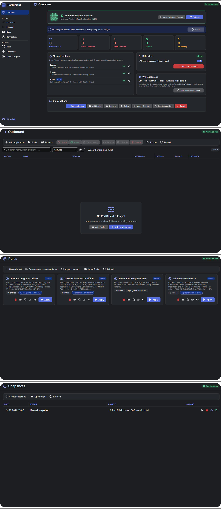

# PortShield

**A modern, open-source firewall rule manager for Windows 10/11 and Windows Server – no telemetry, no ads, no bullshit.**

PortShield turns the Windows Firewall into a simple list of programs. Add single programs, a whole folder or a running program, choose *block* or *allow*, *outbound*, *inbound* or both – and decide whether a program may still reach your **local network** while the **internet** stays closed. **Nothing is written before you have reviewed it.** Before bigger changes PortShield takes a **snapshot** of the complete firewall, so every step can be undone.



## Highlights

- **Program lists** – *Outbound* and *Inbound* show every PortShield rule with action, program, publisher, address scope, profiles and state. Search, filter (blocked, allowed, disabled, program missing), sort and move columns; select many rules at once.
- **Fast adding** – one or many .exe files, a **whole folder** (with sub folders, without installers and uninstallers), a **running program**, or **right-click → Block with PortShield** in Explorer.
- **Review before every change** – PortShield shows for each program whether a rule will be *new*, *changed*, *already exists*, is *protected* or *not found*, and warns when another rule blocks a program you want to allow.
- **Internet only** – block a program's internet access while NAS, printers, license servers and other LAN devices stay reachable.
- **Everything in the context menu** – block, allow, enable, disable, delete, addresses, profiles, rename, copy path, open file location, file properties, run program, select all, invert selection, export.
- **Kill switch** – one click blocks all internet traffic (or everything) – in the sidebar, on the overview and in the tray menu.
- **Whitelist mode** – block outbound traffic by default; only programs with an allow rule get through.
- **Rules (rule sets)** – reusable lists with `%ProgramFiles%`, `*` and `**` wildcards (“Adobe Photoshop *”). Presets for Adobe, TechSmith Snagit, Maxon Cinema 4D and Windows telemetry (also as service rules for DiagTrack); create your own sets in the editor, transfer them to another PC, remove presets you don't need.
- **Watched rule sets** – applied sets are checked for new programs, e.g. a new Adobe or Cinema 4D version in a new folder; the overview offers to apply the missing rules.
- **Allow temporarily** – open a blocked program for 15 minutes up to 2 hours (license activation, update); PortShield blocks it again on time – even after a restart.
- **Integrity check** – PortShield notices when its rules were deleted or changed by a Windows update, an installer, another tool or group policy, and restores them with one click.
- **Blocked connections** – which program tried to reach which address and port, from the Windows security log; block or allow the program right from the list.
- **Exports for everything** – PortShield rule set (JSON), CSV for Excel, path list, **SHA-256 hash list**, **PowerShell script** (also into a GPO), **netsh** batch file, HTML and Markdown report, XML – plus the complete firewall policy (.wfw).
- **Scan & adopt** – finds program rules of other tools (e.g. Firewall App Blocker, wf.msc, installers), duplicates, conflicts and rules of deleted programs; adopt them into PortShield with one click, merge duplicates.
- **Imports** – rule sets, CSV tables (also from other tools, German column names) and plain path lists.
- **Snapshots** – automatically before deleting, importing, rule sets, whitelist mode and reset; restore only PortShield's rules or the complete policy.
- **Reset** – settings only, or everything back to the state after installation.
- **Built for admins** – group policy and domain detection, Windows Server support, protected programs, **command line** (`--block`, `--apply`, `--export`, `--kill-switch` …).
- **Only your rules** – PortShield marks its own rules and never touches Windows or third-party rules unless you select them.
- **Modern interface** – dark mode by default (light and *System* available), collapsible sidebar, icons on every button, English and German.
- **Local-first** – no account, no telemetry, no online features.

## Navigation

| Area | What you'll find |
| --- | --- |
| **Overview** | Protection state, active network, firewall profiles, notices (group policy, other firewalls, service), rule counts, kill switch, whitelist mode, quick actions. |
| **Outbound** | Rules for traffic from programs to the network – add, block, allow, enable, disable, delete, export. |
| **Inbound** | Rules for traffic from the network to programs – same functions. |
| **Rules** | Rule sets – presets and own sets: create and edit in the editor (programs, folders, patterns), apply with review, watch for new programs, save current rules, import, export, remove. |
| **Connections** | Blocked connections (program, direction, remote address and port, protocol, count) – record on/off, filters, block or allow programs. |
| **Scan** | Existing rules by origin (PortShield, other tools, Windows, group policy) and findings; adopt, merge duplicates, clean up. |
| **Snapshots** | Automatic and manual snapshots – restore PortShield's rules or the complete policy. |
| **Import & export** | All export formats with options, import of lists, transfer of rule sets to another PC, complete firewall policy, tips for other security products. |
| **Kill switch** | Block or release all internet traffic with one click. |
| **Settings** | Language, appearance, system tray, defaults for new rules, folder scan, snapshots, protected programs, Explorer context menu, data. |
| **About** | Version, MIT license, components. |

The main action of a dialog is always on the right, *Cancel* to its left.

## Requirements

- Windows 10 / 11 or Windows Server 2016 / 2019 / 2022 / 2025, 64-bit.
- Administrator rights (PortShield asks for them at start – the firewall can only be changed elevated).
- The Windows Defender Firewall must be active (PortShield tells you if another firewall product has turned it off).
- Nothing else: the .NET runtime is included.

## How To – Step by Step

**1 · Download & install**

1. Download `portshield_vX.Y.Z_setup.exe` or `portshield_vX.Y.Z_portable.zip` from the [releases](https://github.com/complicatiion/PortShield/releases).
2. **Setup:** run it (English is preselected, German can be chosen). *Add “Block with PortShield” to the Explorer context menu* is ticked; optionally *Start in the system tray at sign-in*.
   **Portable:** extract it, e.g. to `C:\Tools\PortShield`, and start **`PortShield.exe`**. Settings, rule sets and snapshots are stored in the `data` folder next to it.
3. Optional: **Settings → Language** and **Appearance**.

**2 · Block programs**

1. Open **Outbound** and click **Add application** (or **Folder** / **Process**) – or right-click an .exe file or folder in Explorer → **Block with PortShield**.
2. In the review dialog choose **Outbound**, **Block** and **All addresses** – or **Internet only (LAN allowed)**.
3. Check the list (untick what you don't want) and click **Create rules**.

**3 · Change rules**

1. Select one or more rules (Shift/Ctrl, Ctrl+A).
2. Use the command bar or right-click: **Block**, **Allow**, **Enable**, **Disable**, **Addresses**, **Profiles**, **Rename**, **Delete** …
3. *Also other program rules* shows the program rules of Windows and other apps as well.

**4 · Kill switch and whitelist mode**

1. Click **Kill switch** in the sidebar (or in the tray menu): all internet traffic is blocked; click again to release it. On the overview you can choose whether the LAN stays reachable.
2. **Overview → Whitelist mode** blocks outbound traffic by default – create allow rules for the programs that may go online.

**5 · Rules (rule sets)**

1. **Rules → Save current rules as rule set** stores your rules with portable paths.
2. On another PC: **Import rule set**, then **Apply** – only programs that exist there get rules, after your review.

**6 · Allow temporarily**

1. Select blocked rules in **Outbound** and click **Temporarily** (or right-click → **Allow temporarily**) – 15 minutes, 30 minutes, 1 hour or 2 hours.
2. The overview shows until when; **Block again now** ends it early.

**7 · Blocked connections**

1. Open **Connections** and click **Start recording** (turns on the Windows audit policy for blocked connections).
2. Choose the time range; *Internet only* hides LAN and broadcast noise. Select entries and click **Block program** or **Allow program**.

**8 · Switching from another tool**

1. Open **Scan** and click **Scan**. The filter *Adoptable* lists the program rules of other tools.
2. Select rules (or none for all) and click **Adopt** – optionally *Rename when adopting*. **Merge duplicates** cleans up rules that exist twice.

**9 · Export for other systems**

1. **Import & export**: choose the rules and the format – e.g. **SHA-256 hash list** for a security product, **PowerShell script** for group policy (`-PolicyStore 'domain\GPO'`), **CSV** for Excel.
2. Click **Export …** or **Copy to clipboard**.

**10 · Undo**

**Snapshots → Restore PortShield rules** brings back the rules of that moment; **Restore complete policy** replaces the whole firewall configuration. **Settings → Data → Factory reset** returns PortShield to the state after installation.

**11 · Command line (optional)**

```text
PortShield.exe --block "C:\Program Files\App\app.exe" --internet
PortShield.exe --apply D:\rulesets\workstation.json --confirm
PortShield.exe --export C:\Reports\rules.csv
PortShield.exe --kill-switch on
PortShield.exe --help
```

## Uninstall

- **Setup:** *Windows Settings → Apps → PortShield*. The uninstaller asks whether PortShield's firewall rules should be removed (default: they stay active) and whether settings, rule sets and snapshots should be deleted.
- **Portable:** optionally *Settings → Data → Factory reset* (removes PortShield's rules, autostart and context menu), exit PortShield via the tray and delete the folder.

## Privacy & Security

- Everything runs locally. PortShield sends no data anywhere, has no telemetry and no online features; fonts and icons are embedded.
- PortShield only changes the **Windows Firewall of this computer** – through the official firewall interface of Windows, never by patching files.
- Its own rules carry the group *PortShield* and a marker in the description; rules of Windows and other programs are only changed when you select them yourself.
- Settings: `%AppData%\PortShield`, rule sets and snapshots: `%ProgramData%\PortShield` (portable: `data` next to the app). Details: [licenses/PRIVACY.md](licenses/PRIVACY.md).

## Important Notes

- **Block always wins.** An allow rule cannot open what another rule blocks.
- **Kill switch and whitelist mode** can cut off network access completely – including remote desktop sessions when the LAN is not excluded.
- **Group policy** takes precedence: if it ignores local rules, PortShield's rules have no effect (PortShield shows this on the overview). Ask your administrator before changing a managed firewall.
- **Other firewall products** (e.g. from antivirus suites) often turn the Windows Firewall off – then use the exports for that product instead.
- **Blocked connections** are only recorded while the audit policy is on – it writes to the Windows security log; a domain audit policy may switch it back.
- **Resetting the firewall** removes all own rules of the computer, not only PortShield's – a snapshot is taken first.
- PortShield is a rule manager, **not an antivirus product**: blocking a program's network access does not make an untrusted program safe.

More: [docs/FEATURES.md](docs/FEATURES.md) · Formats: [docs/EXPORT-FORMATS.md](docs/EXPORT-FORMATS.md) · Build: [docs/BUILD.md](docs/BUILD.md) · Changes: [docs/CHANGELOG.md](docs/CHANGELOG.md)

## Credits

The interface is made with **[Avalonia UI](https://avaloniaui.net/)** (incl. DataGrid) and **[CommunityToolkit.Mvvm](https://github.com/CommunityToolkit/dotnet)** on **[.NET](https://dotnet.microsoft.com/)**. Icons: **[Material Design Icons](https://pictogrammers.com/library/mdi/)**, font: **[Inter](https://rsms.me/inter/)**. Inspired by the simplicity of Sordum's *Firewall App Blocker*. Thank you to all authors – licenses in [licenses/README.md](licenses/README.md).

## Project & Copyright

PortShield is a personal software project by **Sven Klocke** (*sksdesign | complicatiion*).

**Project repository:** [github.com/complicatiion/PortShield](https://github.com/complicatiion/PortShield)  
**Website:** [sksdesign.de](https://sksdesign.de)

PortShield is released under the **MIT License** ([licenses/LICENSE.md](licenses/LICENSE.md)). It is provided without warranty; liability is limited to the extent permitted by law – see [licenses/LEGAL-NOTICE.md](licenses/LEGAL-NOTICE.md) and [licenses/COPYRIGHT.md](licenses/COPYRIGHT.md). Third-party components keep their own copyrights and licenses: [licenses/README.md](licenses/README.md).

Windows, Windows Server, Windows Defender, Microsoft Intune, Adobe, Snagit, Bitdefender, ESET and all other names are trademarks of their respective owners. PortShield is not affiliated with or endorsed by them.
